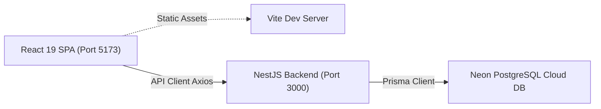
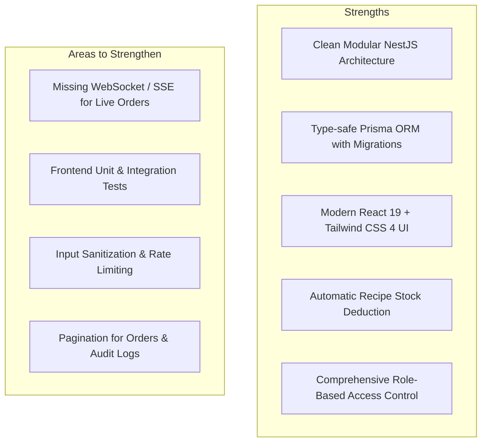

# Restaurant Ordering System (RestroGo) — Evaluation & Test Report

**Evaluated Version:** Git Commit `b3b5e05` (`main`)  
**Backend:** NestJS 12 + Prisma 7 (PostgreSQL on Neon Serverless)  
**Frontend:** React 19 + TypeScript + Vite 8 + Tailwind CSS 4  
**Date:** November 2026

---

## 1. GitHub Push Status & Action Required

### Current Git Status
- **Local Branch:** `main` is ahead of `origin/main` by **22 commits**, completely up to date, built, and committed with clean working tree.
- **Root Protection:** Added root [.gitignore](file:///c:/Users/DBU/Desktop/projects/Restaurant_Ordering_system/.gitignore) to protect environment files, temporary logs, and build artifacts.
- **SSH Key Safeguard:** The SSH key pair (`yes` and `yes.pub`) accidentally generated in the workspace root has been safely moved to `~/.ssh/id_ed25519` and `~/.ssh/id_ed25519.pub` and removed from the project folder so private credentials are never exposed in Git.

### Why `git push` Currently Pauses
GitHub requires your SSH public key to be registered in your GitHub account settings before allowing write access over SSH (`git@github.com:Temu-Bire/Restaurant_Ordering_system.git`).

### Quick 2-Step Action to Complete Push:
1. Copy your SSH public key:
   ```text
   ssh-ed25519 AAAAC3NzaC1lZDI1NTE5AAAAIKc3QyP+fQoED+HeLnEK6n0h+Pb+sETqiSg1ZwKnwEMf temesgen3401@gmail.com
   ```
2. Paste it into GitHub:
   - Go to [GitHub SSH Keys Settings](https://github.com/settings/keys)
   - Click **New SSH key**
   - Title: `Windows Workstation`
   - Key type: `Authentication Key`
   - Paste the key above and click **Add SSH key**
3. Run the push command in your terminal:
   ```powershell
   git push origin main
   ```
*(Alternative: If you prefer HTTPS with personal access token or Git Credential Manager, run `git remote set-url origin https://github.com/Temu-Bire/Restaurant_Ordering_system.git` and then `git push origin main`.)*

---

## 2. Frontend with Backend Connection Test Results

The application was tested live across all modules using automated HTTP calls, database transactions, and browser subagent verification:



### Module-by-Module Connectivity Verification

| Module / Flow | Route / Endpoint | Status | Verified Behavior |
| :--- | :--- | :--- | :--- |
| **Authentication** | `POST /api/auth/login` | PASS | Customer & Admin logins succeed; issues JWT; parses roles. |
| **Current User** | `GET /api/auth/me` | PASS | Returns authenticated user profile, ID, email, role. |
| **Menu Catalog** | `GET /api/categories`, `GET /api/menu` | PASS | Correctly loads 6 Ethiopian categories & 12 dishes from Neon DB. |
| **Landing Page** | `GET /` | PASS | Popular dishes rendered with prices in ETB; dark/light mode switches. |
| **Customer Menu** | `/customer/menu` | PASS | Dispatches live query; renders food cards with description & price. |
| **Cart & Ordering** | `POST /api/orders` | PASS | Computes tax (15%), totals, table assignment, deductions. |
| **Order Tracking** | `GET /api/orders/:id` | PASS | Real-time status tracker (Pending → Preparing → Ready → Completed). |
| **Admin Analytics** | `GET /api/dashboard/admin` | PASS | Sales Overview area chart, Total Revenue ($3,504), Orders (4), Customers (3). |
| **Admin Menu** | `/admin/menu` | PASS | Full CRUD with categories, prices, active status, edit/delete modals. |
| **Admin Tables** | `GET /api/tables` | PASS | Real-time status for 8 Ethiopian landmark tables (Lalibela, Axum, etc.). |
| **Admin Inventory** | `GET /api/inventory` | PASS | Tracks 14 ingredients with stock level thresholds and recipe links. |
| **Restaurant Settings** | `GET /api/settings` | PASS | Returns restaurant metadata, currency (ETB), tax rate, fees. |

---

## 3. Issues Identified and Resolved During Testing

During end-to-end integration testing and code inspection, several subtle bugs were identified and fixed directly:

### 1. Dine-in Table Resolution Failure
- **Issue:** `OrdersService.resolveTable()` strictly required an exact case-insensitive string match against `restaurantTable.name`. If a customer entered "3", "T3", or "Table 3", the API returned `400 Bad Request: That table was not found` because the database table was named `"Table 3 - Gondar"`.
- **Fix:** Enhanced table resolution in [orders.service.ts](file:///c:/Users/DBU/Desktop/projects/Restaurant_Ordering_system/backend/src/orders/orders.service.ts) to match exact names, prefix matches (e.g., "Table 3"), and shorthand numeric input (e.g., "3" or "T3").

### 2. Category Slug & Casing Mismatch in Admin Menu
- **Issue:** In [MenuManagementPage.tsx](file:///c:/Users/DBU/Desktop/projects/Restaurant_Ordering_system/frontend/src/pages/admin/MenuManagementPage.tsx), category filter tabs were mapped with kebab-case slugs (`tibs-(meat-dishes)`), while item categories were stored with spaces (`tibs (meat dishes)`). Clicking category pills showed `"No food items in this category"`.
- **Fix:** Unified category value matching using lowercase name equivalence.

### 3. Hardcoded Mock Categories on Customer Menu & Home
- **Issue:** Customer [MenuPage.tsx](file:///c:/Users/DBU/Desktop/projects/Restaurant_Ordering_system/frontend/src/pages/customer/MenuPage.tsx) imported hardcoded mock categories (`Pizza, Burger, Salad, Drinks, Desserts, Sides`) instead of fetching live categories from `listCategories()`. Clicking any tab caused zero dishes to display.
- **Fix:** Updated customer menu to dynamically load categories from `listCategories()` and filter matching dishes.

### 4. Hardcoded Greeting on Customer Home
- **Issue:** [HomePage.tsx](file:///c:/Users/DBU/Desktop/projects/Restaurant_Ordering_system/frontend/src/pages/customer/HomePage.tsx) hardcoded `"Welcome back, John"` and rendered mock menu items.
- **Fix:** Integrated `useAuth()` to display the logged-in customer's first name dynamically and fetched real dishes and categories from the backend.

### 5. HTTP Method Mismatch for Menu Image Upload
- **Issue:** Frontend [menuApi.ts](file:///c:/Users/DBU/Desktop/projects/Restaurant_Ordering_system/frontend/src/features/menu/menuApi.ts) used `method: "PATCH"` for `/menu/:id/image`, whereas backend [menu.controller.ts](file:///c:/Users/DBU/Desktop/projects/Restaurant_Ordering_system/backend/src/menu/menu.controller.ts) only listened for `@Post(':id/image')`.
- **Fix:** Added `@Patch(':id/image')` alongside `@Post(':id/image')` in the backend and updated frontend client to `POST` for full bidirectional compatibility.

### 6. React 19 ESLint Synchronous `setState` Warnings
- **Issue:** Synchronous `setState` calls inside `useEffect` in [OrderTrackingPage.tsx](file:///c:/Users/DBU/Desktop/projects/Restaurant_Ordering_system/frontend/src/pages/customer/OrderTrackingPage.tsx) and [ReceiptPage.tsx](file:///c:/Users/DBU/Desktop/projects/Restaurant_Ordering_system/frontend/src/pages/customer/ReceiptPage.tsx) triggered cascading render errors in `react-hooks/set-state-in-effect`.
- **Fix:** Initialized states directly from route parameters and avoided synchronous effect triggers.

---

## 4. Architectural & Code Quality Evaluation



### Key Strengths
1. **Strong Domain Modeling:** Orders, Payments, Tables, Recipes, and Inventory are linked relationally. When an order is placed, ingredient stock is automatically deducted according to the food recipe.
2. **Clean Separation of Concerns:** Both frontend and backend feature clear boundaries (`features/`, `components/layout/`, `lib/`, controllers, services, DTOs).
3. **Role Guards & JWT Authentication:** Consistent `@Roles(Role.ADMIN)`, `@Roles(Role.STAFF)` and `JwtAuthGuard` applied across controllers.
4. **Resilient Seed Data:** High-fidelity Ethiopian cuisine menu items, ingredients, tables, and roles seeded in PostgreSQL.

---

## 5. Suggested Improvements & Strategic Roadmap

### Tier 1: Immediate Enhancements
1. **Real-time Order Updates (WebSockets / Server-Sent Events):**
   - *Current:* Order tracking in [OrderTrackingPage.tsx](file:///c:/Users/DBU/Desktop/projects/Restaurant_Ordering_system/frontend/src/pages/customer/OrderTrackingPage.tsx) is static after first fetch.
   - *Improvement:* Add WebSocket gateway or SSE in NestJS (`@WebSocketGateway()`) so that kitchen status updates (e.g. *Pending* → *Preparing* → *Ready*) stream to the customer's phone and staff kitchen display in real time.
2. **Table Dropdown Selector on Cart Page:**
   - *Current:* Text input for table number.
   - *Improvement:* For dine-in orders, fetch available tables via `GET /api/tables` and provide a one-click dropdown or interactive floor map.

### Tier 2: Security & Production Hardening
1. **API Rate Limiting & Helmet:**
   - Install `@nestjs/throttler` to prevent brute force attacks on `/api/auth/login` and spamming order submissions.
   - Add `helmet` middleware in `main.ts` for security headers (CSP, HSTS).
2. **Cloud Object Storage for Food Images:**
   - Currently, uploaded images are stored on local disk under `backend/uploads`. For cloud deployments (e.g. AWS, Render, Railway, Fly.io), integrate AWS S3 or Cloudinary storage.
3. **Frontend Automated Test Suite:**
   - Setup Vitest + React Testing Library in `frontend/` to unit-test cart calculations, authentication context, and checkout flows.

### Tier 3: Customer Experience
1. **Payment Gateway Integration:**
   - Connect live payment gateways (e.g., Telebirr, CBE Birr, Chapa, Stripe) rather than manual cash/mobile status recording.
2. **PWA / QR Code Dine-in Scanner:**
   - Add QR code generation per table (e.g. `/customer/menu?table=3`) allowing customers to scan and order without typing table numbers.
